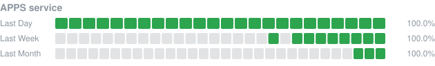
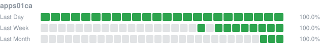

# apps-ping





An hourly end-to-end health check of JPL's
[Automatic Precise Point Positioning service (APPS)](https://apps.jpl.nasa.gov).
Each hour, a GitHub Actions workflow submits a day of RINEX data from the USN8
station to every configured APPS processor, approves it, and on the next run
checks that it was processed. If anything goes wrong it sends a push
notification through [ntfy](https://ntfy.sh).

## Reading the uptime bars

Each image has three rows, each covering a rolling window that ends at the
latest run (newest cell on the right, times in UTC):

| Row        | Cells | Each cell is |
| ---------- | ----- | ------------ |
| Last Day   | 24    | one hour     |
| Last Week  | 28    | 6 hours      |
| Last Month | 30    | one day      |

The number on the right of each row is the uptime across that whole row.
Since there's one check an hour, a cell in the Last Day row is either green or
red.

| Color  | Meaning                                         |
| ------ | ----------------------------------------------- |
| Green  | every check succeeded                           |
| Yellow | some checks succeeded, but not all              |
| Red    | every check failed                              |
| Gray   | no checks ran                                   |

The **APPS service** image counts an hour as up if at least one processor
passed its check. Each processor has its own image too.

The images are rendered from [`ping.log`](ping.log), which gets one line per
processor per run:

```
2026-11-22T05:17:00Z apps01ca OK
2026-11-22T06:17:00Z apps01ca OK previous ping still processing
2026-11-22T07:17:00Z apps01ca FAIL Upload of apps-ping-apps01ca-20261122T071700Z failed: ...
```

`OK previous ping still processing` means the check was healthy, but no new
submission was uploaded because the last one has not finished yet (it has up to
an hour). `FAIL` and `ERROR` lines have also been sent as notifications.

## How a check works

The workflow ([`.github/workflows/ping.yml`](.github/workflows/ping.yml)) is
started at 7 minutes past every hour by a Cloudflare Worker (see
[Hourly trigger](#hourly-trigger)). For each processor, the check
([`src/apps_ping/ping.py`](src/apps_ping/ping.py)):

1. Finds the newest submission named `apps-ping-<processor>-<time>` and checks
   it:
   * Processed successfully: fine.
   * In the Error state, or carrying an error flag: **notify**.
   * Still in progress after more than 60 minutes: **notify** (stuck).
   * Still in progress but newer than that: approve it if it is waiting on
     approval, then stop without uploading another, so pings don't pile up on a
     busy service.
2. Deletes old ping submissions to stay under the account quota. It keeps the
   newest one and the last 3 that failed, so failures can be looked at.
3. Uploads [`data/usn83250.26o.gz`](data/usn83250.26o.gz) to that processor,
   waits up to 10 minutes for it to be verified, and approves it. Any upload,
   verification or approval failure **notifies** straight away. Whether it
   processes is checked by the next run.

After a problem it still uploads a fresh submission, so the next run checks the
new one instead of reporting the same problem again. During an outage this
sends roughly one notification every 2 hours.

All problems found in one run go out as a single notification. If every
processor failed, its title is **APPS service DOWN**. If the workflow fails in
a way the check can't report (for example, installing dependencies fails), a
final workflow step sends the notification instead.

## Configuration

| Setting                | Where                     | Default          |
| ---------------------- | ------------------------- | ---------------- |
| `APPS_SETTINGS`        | repository **secret**     | (required)       |
| `APPS_PING_PROCESSORS` | repository **variable**   | `apps01ca`       |
| `NTFY_TOPIC`           | repository **variable**   | `apps-ping-usn8` |

* `APPS_SETTINGS` is the contents of the APPS credential file, which you can
  download from your [APPS account settings](https://apps.jpl.nasa.gov/account/settings).
* `APPS_PING_PROCESSORS` is a comma separated list of the processor labels to
  check.
* Subscribe to `NTFY_TOPIC` in the ntfy app to get the notifications.

Set variables under **Settings > Secrets and variables > Actions**, or with
`gh variable set APPS_PING_PROCESSORS --body "apps01ca,apps02xx"`.

## Hourly trigger

GitHub's `schedule` trigger is best effort and often skips runs, so a small
Cloudflare Worker in [`dispatcher/`](dispatcher) starts the workflow at 7
minutes past every hour through GitHub's `workflow_dispatch` API. If GitHub
rejects the request (for example, because the token expired), the Worker sends
an ntfy notification.

The workflow's own schedule, at 17 past the hour, is kept as a backup. It
stands down if the last line in `ping.log` is less than 40 minutes old.

The Worker needs a `GITHUB_TOKEN` secret: a
[fine-grained personal access token](https://github.com/settings/personal-access-tokens/new)
limited to this repository, with **Actions: Read and write** permission. To set
it up or change it:

```bash
cd dispatcher
npm install
npx wrangler login
npx wrangler secret put GITHUB_TOKEN   # paste the token when prompted
npx wrangler deploy
```

Logs are under **Workers & Pages > apps-ping-dispatcher > Logs** in the
Cloudflare dashboard, or run `npx wrangler tail` from `dispatcher/`. When the
token expires, create a new one and run `wrangler secret put` again.

## Running locally

```bash
just install
# put your credential in .apps_settings (it is gitignored)
APPS_SETTINGS_FILE=.apps_settings uv run apps-ping data/usn83250.26o.gz --log ping.log
uv run apps-ping-uptime ping.log uptime
```

Run `uv run apps-ping --help` for the other options. A local run sends real
notifications if something fails.

## Notes

* The workflow commits `ping.log` and `uptime/` back to `main` every hour, so
  pull before you push.
* Those hourly commits also stop GitHub from disabling the schedule, which it
  does to public repositories after 60 days with no activity.
* The APPS client library is installed from the wheel in the repository root.
  Its `httpsig` dependency still needs `pkg_resources`, so `setuptools` is
  pinned below 81.
